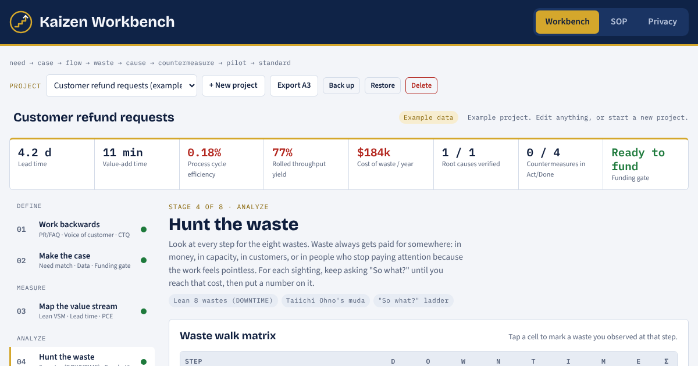
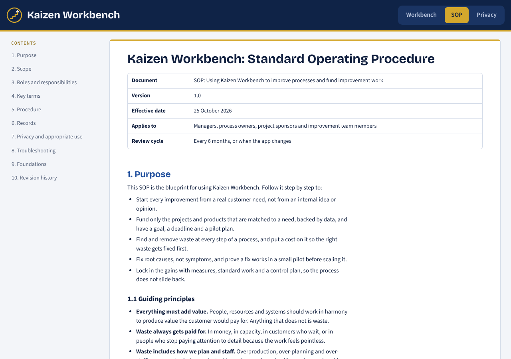
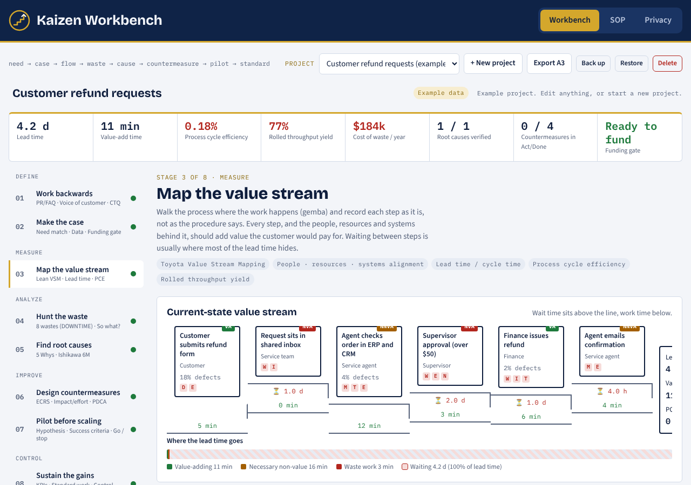
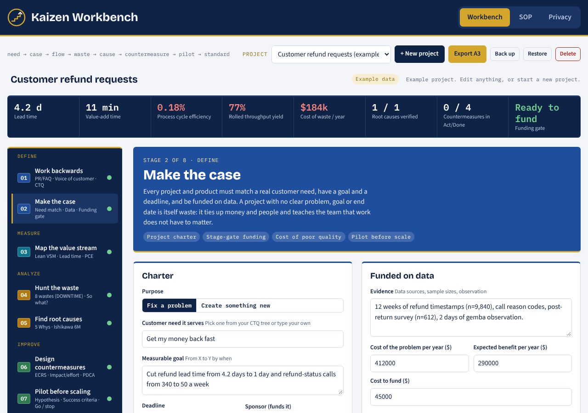

# Kaizen Workbench

**A process-improvement app for managers.** Start from what the customer needs, fund only the work that serves that need, and remove waste at every step of the process.

**[Open the live app →](https://karentinoco13-alt.github.io/kaizen-workbench/)**

## Why I built it

Waste always gets paid for somewhere: in money, in capacity, in customers, or in people who stop paying attention to detail because their work feels pointless. That includes overproduction, over-planning and over-staffing. It also includes projects with no clear goal, no deadline and no real problem to solve.

Kaizen Workbench is built on one principle: **everything in an organization must add value.** People, resources and systems should work together to produce value the customer would pay for. Every project and product must be matched to a real need, funded on data, and piloted before it is scaled.

## How it works

The app walks a manager through eight stages. Each stage uses a proven method from process improvement, quality management or innovation.

| # | Stage | Methods |
|---|---|---|
| 1 | **Work backwards** from the customer | Amazon's Working Backwards (PR/FAQ), voice of the customer, Six Sigma critical-to-quality (CTQ) tree |
| 2 | **Make the case** | Project charter and a funding gate with 9 checks: customer need, measurable goal, deadline, owner, data, cost of the problem, benefit vs. cost, pilot plan. Projects with no need, goal or deadline are flagged as **zombie risk** |
| 3 | **Map the value stream** | Toyota value stream mapping, lead time, process cycle efficiency, rolled throughput yield, and a check that **people, resources and systems** support each step |
| 4 | **Hunt the waste** | The 8 wastes of Lean (DOWNTIME), extended to over-planning, over-staffing and disengagement, with a **"So what?"** ladder that ends in customer impact and a yearly dollar cost |
| 5 | **Find root causes** | Toyota's **5 Whys** with a "therefore" test that reads the chain backwards, Ishikawa 6M categories, and verification with data |
| 6 | **Design countermeasures** | ECRS (Eliminate, Combine, Rearrange, Simplify), impact vs. effort matrix, Deming's Plan-Do-Check-Act |
| 7 | **Pilot before scaling** | Hypothesis, small scope with a comparison group, success and stop criteria set in advance, then scale, adjust or stop |
| 8 | **Sustain the gains** | KPIs from baseline to target, standard work, control plan |

A live metrics strip shows lead time, value-add time, process cycle efficiency, yield, the yearly cost of waste, verified root causes, countermeasure progress and the funding gate status.

**Export A3** turns the whole project into a one-page Toyota-style A3 report in Markdown.

## SOP: the blueprint

The **SOP** tab in the app is a full standard operating procedure that teaches people how to use it properly: purpose and guiding principles, roles, key terms, a step-by-step procedure for every stage with a clear "Done when" condition, a weekly rhythm, what to do when the app shows a warning signal, troubleshooting, and the research foundations behind each method. Each stage in the SOP links straight to that stage in the app.

The same SOP is in this repository as [SOP.md](SOP.md), and in Spanish as [SOP.es.md](SOP.es.md).

The app opens with a fully worked example (customer refund requests) so you can see every stage in use.

## English and Spanish

The whole app works in English and Spanish. Use the **EN | ES** switch in the header. Every screen, the SOP, the privacy notes, the example project and the exported A3 report change language. What you type stays as you wrote it. The app opens in Spanish for browsers set to Spanish and remembers each person's choice. To share the Spanish version directly, use [this link](https://karentinoco13-alt.github.io/kaizen-workbench/#es).

## Privacy

Your projects never leave your browser. There is no account, no server and no tracking. Work saves automatically in the browser's local storage on your computer. Use **Back up** to save a copy as a file and **Restore** to load it elsewhere. The **Privacy** tab in the app explains this in full.

## Terms, deleting data and feedback

- **Terms of use** are linked at the bottom of every page. Every plan is unique to the person, manager and company that create it and depends on the data entered, so the app does not guarantee any result without proper monitoring of the whole journey and of all the data relevant to it. Every exported A3 ends with the same reminder.
- **Delete all my data** (in Privacy) removes every project and saved setting at once, with the same two warnings.
- **Deleting a project takes two warnings.** The first offers a backup. The second asks the person to accept that they alone are responsible for the loss, releasing the app and its developer and giving up any claim over lost data. The delete button stays disabled until they tick that box.
- **Feedback** has its own tab. It prepares a GitHub issue that the person reviews and posts, or they can copy it and send it another way. Feedback is used to plan future versions.

## Tech

One self-contained HTML file with plain JavaScript and CSS, in a navy and gold brand shared with my other apps. No framework, no build step and no dependencies apart from Google Fonts. It works on desktop and mobile, in light and dark mode. Hosted on GitHub Pages.

To run it locally, download `index.html` and open it in a browser.

## Roadmap

- Shared team workspace with sign-in
- Portfolio view of every project's funding gate status and cost of waste
- AI coach that reviews each stage and challenges weak reasoning

## License

Required Notice: Copyright (c) 2026 Karen Tinoco (https://www.thehumanelement.live)

Kaizen Workbench by Karen Tinoco · © 2026 Karen Tinoco. Licensed under the [PolyForm Noncommercial License 1.0.0](LICENSE.md): free to use, share and adapt for non-commercial purposes, with credit. Commercial use by permission only.
